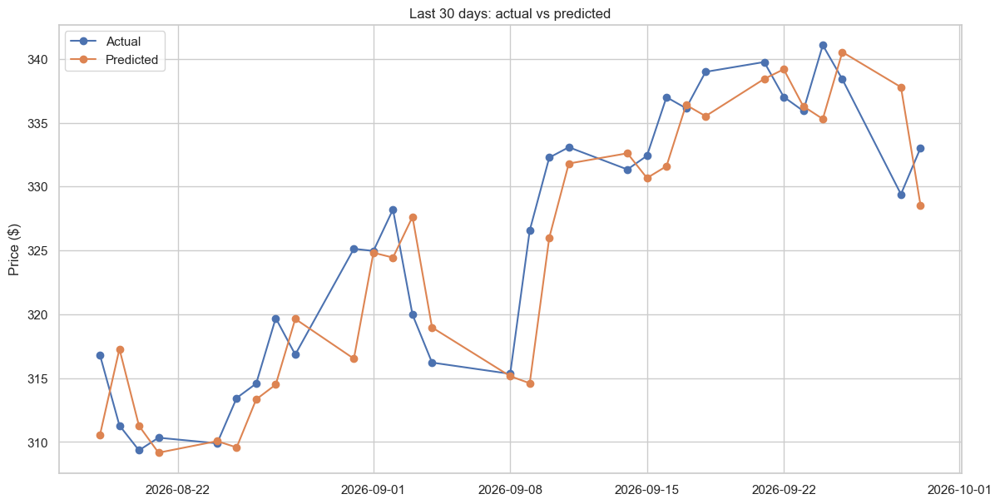
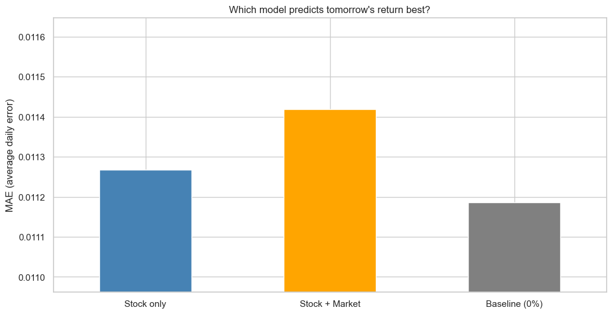

# Apple (AAPL) Stock Prediction with Linear Regression

An end-to-end machine-learning project that tries to forecast Apple's **next-day stock price and return** from 5 years of daily market data. It focuses on **honest evaluation**: every model is compared against a naive baseline, using a chronological train/test split.

**[Open the notebook](apple_stock_regression.ipynb)**

## Key results

| Task | Model | Naive baseline | Verdict |
|---|---|---|---|
| Next-day **price** | MAE $3.24 · R² 0.971 | MAE $3.20 · R² 0.971 ("tomorrow = today") | No real improvement |
| Next-day **return** (stock features) | MAE 1.127% | MAE 1.119% (predict 0%) | No predictive power |
| Next-day **return** (+ S&P 500 & VIX) | MAE 1.142% | MAE 1.119% | Market context doesn't help |

**Takeaways**

- A 97% R² on stock prices looks impressive but is misleading: prices are highly autocorrelated, so the model simply learns to copy today's close.
- Technical indicators (returns, moving averages, volatility) and market context carry almost no information about tomorrow's return, which is consistent with the weak-form efficient market hypothesis.
- AAPL is strongly correlated with the S&P 500 on the **same day** (0.72), but not on the **next day** (≈ 0).



*The prediction lags the actual price by one day, the signature of a model that repeats the last known value.*



## Methodology

1. **Data:** daily OHLCV prices for AAPL, the S&P 500 (`^GSPC`) and the VIX (`^VIX`) from Yahoo Finance, Oct 2021 to Oct 2026.
2. **Features:** daily return, 5/20-day moving averages, 5-day volatility, distance from moving averages, S&P 500 return, VIX level and change.
3. **Split:** first 80% of days for training, last 20% for testing (no shuffling, so no look-ahead bias).
4. **Model:** scikit-learn `LinearRegression`.
5. **Metrics:** MAE, RMSE, R², always compared with a naive baseline.

## Run it locally

```bash
git clone https://github.com/sankara226/APPLE-STOCKS-REGRESSION-MODEL.git
cd APPLE-STOCKS-REGRESSION-MODEL
pip install -r requirements.txt
jupyter notebook apple_stock_regression.ipynb
```

Or open it directly in Google Colab.

## Next steps

- Walk-forward validation instead of a single split
- Non-linear models (Random Forest, Gradient Boosting, LSTM)
- Up/down classification framing
- Extra signals: earnings dates, news sentiment, sector ETFs

## Tech stack

Python · pandas · NumPy · scikit-learn · matplotlib · seaborn · yfinance · Jupyter

---

*Educational project, not financial advice.*
